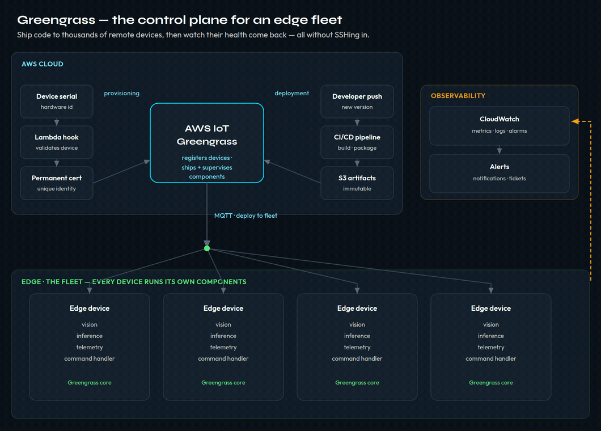

# greengrass-fleet-demo

A tiny, end-to-end example of managing an **edge device fleet** with [AWS IoT
Greengrass](https://docs.aws.amazon.com/greengrass/v2/developerguide/) — from a
device registering itself on first boot, to shipping a component to the whole
fleet, to watching its health come back.

You can SSH into one device to update it. Try doing that on a thousand. This repo
shows the control plane that makes it unnecessary.



> This is a **generic, educational** demo. The code recreates the *pattern* from
> scratch — adapt the serial scheme, fleet groups, bucket and policies to your own
> setup.

---

## The flow, step by step

The whole lifecycle, in the order the diagram shows it:

| # | Step | What happens |
|---|------|--------------|
| 1 | **Provisioning** | A device registers itself on first boot and gets its own identity |
| 2 | **Greengrass core** | Runs local workloads on each device and manages the fleet |
| 3 | **Developer push** | A commit kicks off the pipeline with a new version |
| 4 | **CI/CD pipeline** | Builds, packages, and publishes the component to Greengrass |
| 5 | **S3 artifacts** | Stores the immutable build artifact |
| 6 | **Edge devices** | Receive the new version over MQTT and install it |
| 7 | **Observability** | Devices report metrics and logs back, closing the loop |

The thing that clicks once you build this: **provisioning and deployment are two
different problems.** One is about *identity* (steps 1–2), the other about
*software* (steps 3–6). Keep them decoupled and the whole thing scales. And the
**CI/CD pipeline is what updates Greengrass** — not a person.

---

## 1–2. Provisioning — zero-touch

Every device is flashed with the **same image**, carrying only a shared *claim
certificate*: a disposable entry ticket that can do nothing but ask for a real
identity. On first boot the device sends its serial, and a **pre-provisioning
hook** ([`handler.py`](provisioning/pre-provisioning-hook/handler.py)) decides
whether it's allowed in. If it checks out, AWS creates the Thing, issues a
**permanent certificate**, and drops it into a thing group. The claim cert is
then deleted. The device now runs the **Greengrass core**, which executes local
workloads and stays managed from the cloud.

One image → many devices, each with its own identity, no manual steps.

```bash
cd provisioning/pre-provisioning-hook
python test_handler.py   # the gatekeeper logic, unit-tested
```

- [`handler.py`](provisioning/pre-provisioning-hook/handler.py) — the validation hook
- [`fleet-provisioning-template.json`](provisioning/fleet-provisioning-template.json) — what AWS creates when a device is allowed in

**Why the claim/permanent split matters:** a leaked claim certificate on its own
is useless — the hook still has to say yes. And a compromised permanent cert only
affects *that one* device, not the fleet.

---

## 3–6. Deployment — the pipeline updates the fleet

A **developer push** kicks off **CI/CD**: build, package, upload an **immutable**
artifact version to **S3**, then register the component version and create a
deployment targeting a **thing group**. Greengrass pushes it over MQTT and every
**edge device** in the group installs it — in minutes, no reboot. The pipeline is
what talks to Greengrass; you don't touch the devices.

```bash
export BUCKET=your-bucket ACCOUNT_ID=123456789012 THING_GROUP=fleet-a

./scripts/1-publish-component.sh   # upload artifact + register component version
./scripts/2-deploy-to-fleet.sh     # deploy that version to the whole group
```

- [`com.example.hello-fleet`](components/com.example.hello-fleet) — a minimal long-running component
- [`recipe.yaml`](components/com.example.hello-fleet/recipe.yaml) — how each device installs and runs it

> Components are **immutable**: you never edit `1.0.0`, you publish `1.0.1`.
> Publishing a component does **not** install it — you always need a deployment too.

---

## 7. Observability — closing the loop

Deploying blind isn't enough. Devices report metrics and logs back to CloudWatch,
alarms fire on the ones that matter, and notifications / tickets get raised. So
it's not "deploy and hope" — you actually see the fleet's health come back. That
return path is the orange cable in the diagram above.

---

## Layout

```
provisioning/
  pre-provisioning-hook/   the gatekeeper Lambda (+ tests)
  fleet-provisioning-template.json
components/
  com.example.hello-fleet/ example component (recipe + artifact)
scripts/
  1-publish-component.sh   upload + register a component version
  2-deploy-to-fleet.sh     deploy it to a thing group
```

## Notes

- Requires the AWS CLI configured, and a Greengrass core device (or the
  [Greengrass Docker image](https://docs.aws.amazon.com/greengrass/v2/developerguide/run-greengrass-docker.html))
  to actually receive deployments.
- Region defaults to `eu-west-1`; override with `REGION=...`.
